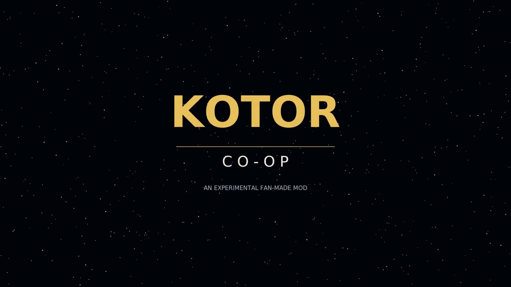
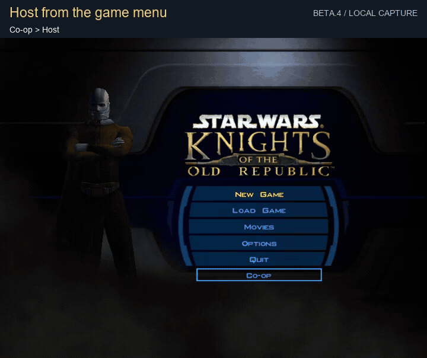
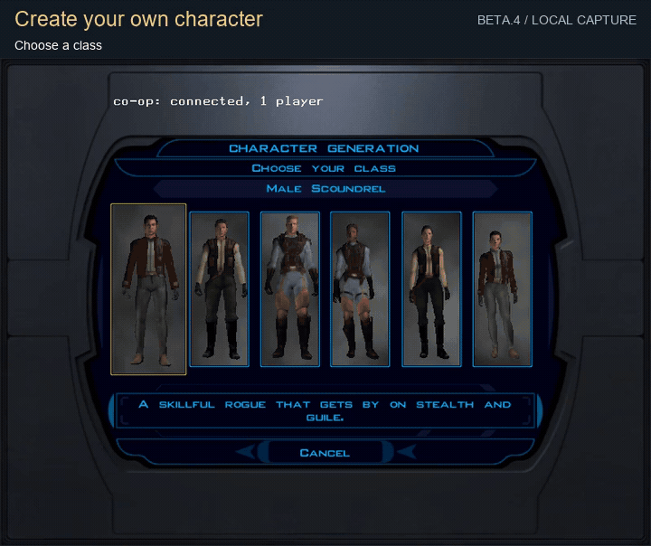
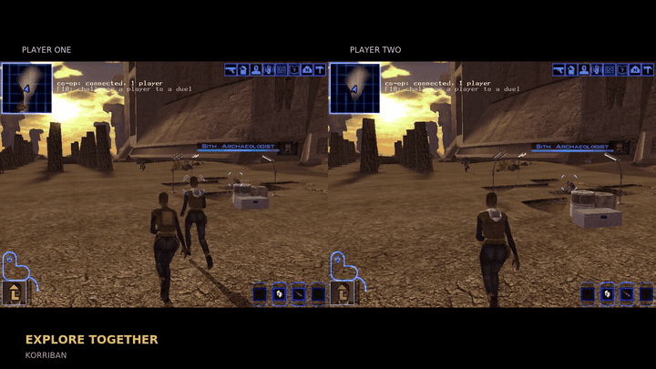
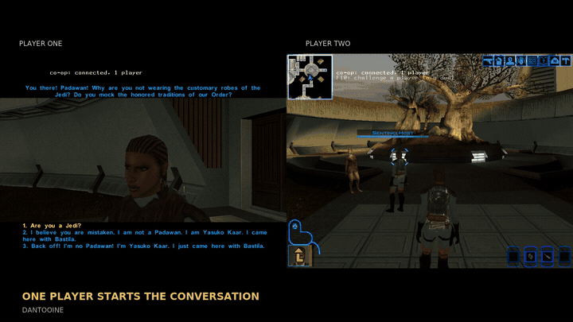
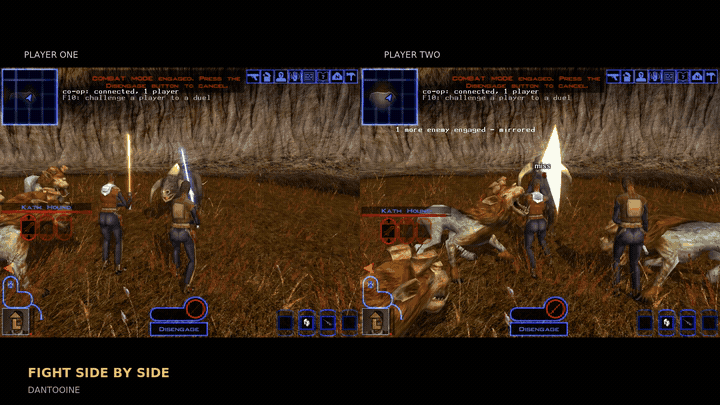
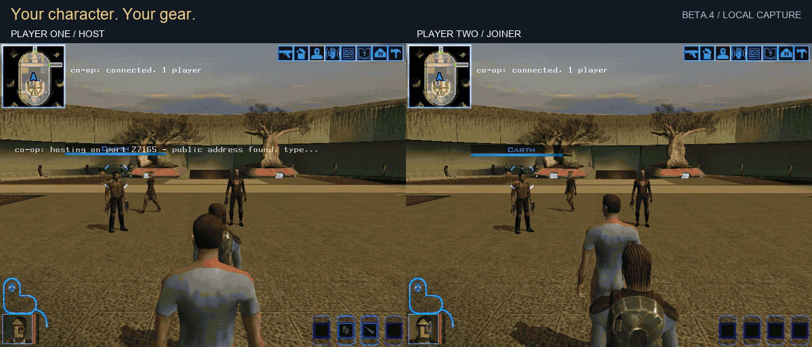
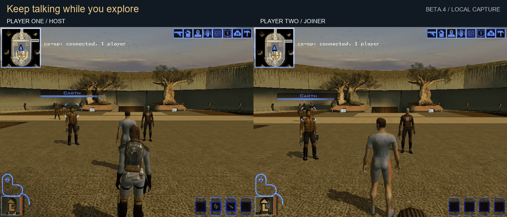
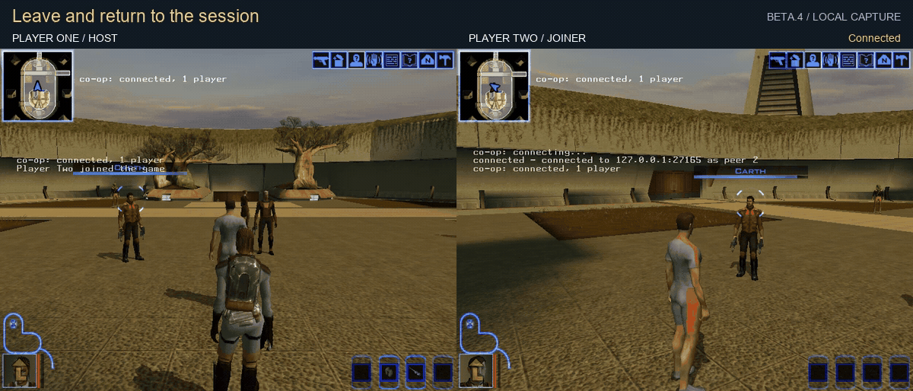

# KOTOR, played together.



[](https://github.com/ChristopherVR/kotor-coop/actions/workflows/ci.yml)
[](https://github.com/ChristopherVR/kotor-coop/releases/latest)
[](LICENSE)


**Your own character. A shared adventure. A friend beside you.**

A free, open-source co-op mod for **Star Wars: Knights of the Old Republic**. One player hosts;
friends join the same world from their own copies of the game. Explore, fight and share the
story through the original game's menus, with a new **Co-op** button to bring you together.

**[Download the latest release](https://github.com/ChristopherVR/kotor-coop/releases/latest)** ·
[Get it on Nexus Mods](https://www.nexusmods.com/mod/1910) ·
[Watch the trailer](https://christophervr.github.io/kotor-coop/#trailer) ·
[Player guides](https://christophervr.github.io/kotor-coop/)

> **Experimental beta — start with two players and back up your saves.** Selected scenes have
> been tested on real game copies; a complete co-op campaign has not been verified. Up to eight
> players can connect, but larger-group campaign reliability remains experimental.

## See it in action

Real game footage, recorded using **two game copies on one PC** and disposable saves.
The menu, character, inventory, chat and reconnect clips were captured on **v0.1.0-beta.4**
using the background game harness. Cuts are labeled; each new GIF has a pauseable MP4.
The exploration, dialogue and combat clips come from our earlier
[gameplay trailer](https://christophervr.github.io/kotor-coop/#trailer).

### Host from the game menu



Open **Co-op → Host** to bring your save into a session. **Shown here:** starting a host in
the Jedi Enclave on Dantooine. The loading wait is cut from the loop.
[Watch or pause this clip](https://christophervr.github.io/kotor-coop/media/showcase/host-from-menu.mp4).

### Create your own character



A first-time join opens the game's character creator. **Shown here:** class and portrait
choices for the new Soldier who joined this session. The clip cuts between those two steps.
[Watch or pause this clip](https://christophervr.github.io/kotor-coop/media/showcase/create-character.mp4).

### Explore together



See your friend as a character in the world. Walk together, follow each other through area changes,
and take the same trip between planets. **Shown here:** paired views of movement on Korriban.

### Share the conversation



Whoever starts a conversation chooses the replies. The other player selects the same character
to watch; story-triggered scenes bring the party in automatically. **Shown here:** joining a
conversation with Belaya on Dantooine. One conversation runs at a time.

### Fight side by side



Fight shared enemies with your own character and gear. **Shown here:** blue and yellow sabers
against kath hounds on Dantooine. God mode was used for filming; this clip demonstrates shared
combat, not ordinary difficulty or balance.

### Your character. Your gear.



Open your backpack and character sheet independently. **Shown here:** the established host
has gear, while the newly created Soldier has an empty backpack and his own stats.
[Watch or pause this clip](https://christophervr.github.io/kotor-coop/media/showcase/personal-inventory.mp4).

### Keep talking while you explore



Messages appear inside both players' games. **Shown here:** a two-way chat exchange in the
Enclave courtyard, sent through the harness's console commands.
[Watch or pause this clip](https://christophervr.github.io/kotor-coop/media/showcase/in-game-chat.mp4).

### Leave and return



**Shown here:** Player Two disconnects and reconnects while the host stays in the courtyard.
The character disappears and returns in the host's view. This is a session reconnect with
both games still running; the loop cuts out the save and connection waits.
[Watch or pause this clip](https://christophervr.github.io/kotor-coop/media/showcase/leave-and-rejoin.mp4).

These staged clips illustrate selected features; a completed campaign and independent internet
playtest remain unverified. [New capture details](site/media/showcase/capture-20261030.json) ·
[Trailer capture details](site/media/provenance.json) ·
[GIF sources, edits and hashes](site/media/showcase/manifest.json).

## Install, host, connect

1. **Download** `kotor-coop-<version>-setup.exe` from the
   [latest release](https://github.com/ChristopherVR/kotor-coop/releases/latest).
   On Nexus, extract the Main file ZIP to find the same setup program.
2. **Close KOTOR and run setup.** It finds your GOG or Steam copy, or lets you choose the folder.
   Allow the firewall rule if you want to host. Install through setup, not Vortex.
3. **Start KOTOR → Co-op → Host.** Use an existing save, or a new game after the first autosave.
4. **Your friend chooses Co-op → Connect**, selects the host, or enters the host's address.
   On the first join, the normal character-creation screen lets them make their own character.

Both players need **the same co-op version**. Start with matching game mods too. Internet hosting
may need port forwarding or a tunnel; the mod does not supply a relay server. See the
[host/join guide](https://christophervr.github.io/kotor-coop/play.html).

While connected, load the save called **Co-op** to resume your session. Your own autosave is
backed up as **Autosave before co-op**. Press **Enter** to chat and **~** for the console.

<details>
<summary>ZIP installation, Windows prompts and Linux packages</summary>

Prefer the plain Windows ZIP? Extract it into its own folder (not over the game) and run
`KotorCoop.Agent.exe`. It provides the same installation flow. The files are not code-signed,
so SmartScreen may warn. Release assets include `SHA256SUMS.txt` to verify your download;
report antivirus detections rather than adding exclusions.

The Linux / Steam Deck tarball includes `install.sh` for Proton or Wine. The Linux installer
is tested; Linux gameplay remains unverified. See [Steam and Linux](#steam-and-linux).

</details>

## What works, and where the limits are

| Feature | What you can do | Current limit |
| --- | --- | --- |
| Join and reconnect | Host from the game menu, join as your own character, leave and return | Separate-PC internet and automatic router setup need wider testing |
| Explore and travel | See each other, change areas, take the same planet trip | Brief position correction can happen after loading |
| Combat | Fight the same enemies with your own gear; enemies scale for a group | Staged fights are tested; full-campaign balance is not verified |
| Dialogue and story | Watch the same conversation; share quest and journal progress | One speaker chooses replies; recent dialogue fixes still need ordinary retesting |
| Inventory and shops | Keep personal backpacks and credits; share quest items and merchant stock | The host controls companion equipment; simultaneous container access needs retesting |
| Saves and recovery | Save/load in co-op and automatically rejoin after a game disconnect | Unsaved progress can be lost; a host helper crash requires hosting again |
| Minigames | Play Pazaak, swoop racing and turret encounters | One player plays; everyone else waits |
| Larger parties | Connect up to eight players; group travel and combat have been demonstrated | Start with two; three-to-eight-player campaign reliability is experimental |

These are summaries of recorded results, not a promise that every scene works. **Recent fixes
for dialogue over equipment menus, Trask disappearing, container access, save-name input,
subtitles/skipping and the post-save enemy banner still need ordinary in-game confirmation.**
A complete two-player campaign, the full ending chain and independent-PC/Steam invite scenarios
remain unverified unless specifically recorded.

[Detailed player limitations](docs/limitations.md) ·
[Engineering status and evidence](docs/status-engineering.md) ·
[Current release checklist](docs/RELEASE-READINESS.md)

## What you need

- **KOTOR 1 v1.0.3**, GOG or Steam, lawfully owned by each player. KOTOR 2 is not supported.
- **64-bit Windows** for the verified gameplay baseline. Linux/Steam Deck packaging is available.
- Matching co-op versions, matching game mods for your first session, and backed-up saves.
- For two instances on one PC: separate game folders and at least one GOG copy; Steam allows
  only one running copy. The baseline captures use the game's 800×600 view; full widescreen
  and replacement-menu compatibility remain under test.

## About the project

This began as an experiment in adding co-op to a 2003 game through memory scanning and engine
hooks, without its source code. The design takes inspiration from Elden Ring's Seamless Co-op:
one player hosts, friends drop in, and each keeps their own character. The reverse-engineering
notes and unsuccessful experiments are kept alongside the code for other modders to use.

<details>
<summary>The experiment, how it grew, and other KOTOR co-op projects</summary>

## Where this came from

This project did not start as a mod. It started as a question: **how far can you take a 2003 game with
nothing but memory scanning and hooking, and no source code and no engine access?**

KOTOR has no networking layer for its story mode at all, and the community's long-standing answer was
that co-op is impossible without the executable's source. So the early versions did the obvious
experiment. A separate program attached to the running game, found the player's position in memory by
scanning for values and diffing snapshots, read it, and wrote the other player's position back. That
moved what the renderer drew but not what the simulation knew, so the "other player" had no collision
and could not be hit or talked to. The interesting part was everything we had to learn to fix that:

- **Finding things without symbols.** Signature scans against the *running* process (the executable on
  disk is packed, so the bytes in `.text` are not the bytes that execute), value-diff scans, and
  pointer paths from static globals. See [docs/FINDING-OFFSETS.md](docs/FINDING-OFFSETS.md) and
  [docs/re/](docs/re/).
- **Driving the engine instead of poking it.** Raw memory writes leave derived state stale, so the plugin
  spawns real creatures and moves them through the engine's own object system, the same calls a script
  would make. The notes on what those calls are, and the ones that crashed, are in
  [docs/research/](docs/research/README.md).
- **Hooks, kept to a minimum.** A small native plugin loaded as `dinput8.dll` (the game loads it by
  itself, so the executable on disk is never modified) installs a handful of hooks: one per frame, one
  in the main loop (which also runs at the menu) and one on the developer console's command interpreter.
  Everything else is calls into the engine.
- **A lot of trial and error.** The research directory is a lab notebook: roughly 150 write-ups of what
  worked, what crashed and why, kept because the dead ends are as useful as the findings.

The co-op mod is a **side effect** of that experiment. Once the avatars were real objects the engine
treated like any other creature, sharing doors, dialogue, combat, journals and saves became a series of
solvable problems, and at some point it turned into something people could actually play.

Because of that history, the codebase is unusual: an x86 NativeAOT C# plugin inside the game, an x64
helper that talks to it over a shared memory block, a UDP star topology with the host as authority, and a
large amount of reverse-engineering knowledge written down alongside the code. If you want to learn how
KOTOR's engine ticks, the documentation may be worth more than the mod.

### Elden Ring-style "seamless"

The design target was Elden Ring's Seamless Co-op, not a traditional multiplayer lobby. Concretely:

- **No server to run.** Whoever is hosting is just a player; everyone talks to the host.
- **Drop in, drop out.** Join a running game, leave, rejoin. A crash on either side is survived.
- **Your character is yours.** You keep your own character, backpack and credits, and the shared world
  (doors, containers, quests, enemies, the map) is the host's.
- **The game stays the game.** You play the normal campaign in the normal UI; the mod adds a Co-op
  button, a chat line and a console verb or two.

[docs/ARCHITECTURE.md](docs/ARCHITECTURE.md) compares what Elden Ring gives its co-op mod for free with
what had to be built here for KOTOR.

## Other KOTOR co-op projects

We are not the only ones working on this, and **the other projects may well turn out better in the long run.**
Two more recent ones we know of:

- [**masterxxstabs/KOTOR-COOP**](https://github.com/masterxxstabs/KOTOR-COOP): a persistent dedicated
  server that keeps the campaign state alive when nobody is playing, with a launcher and server browser
  and a client DLL. A "world that persists" design rather than a "drop in on a friend" one.
- [**McChaffeeFAF/kotor-coop**](https://github.com/McChaffeeFAF/kotor-coop): a fork of the
  reone open-source engine reimplementation with online co-op.
  Because it owns the engine, it does not depend on hooking the original executable.

Both have clear advantages over this project's approach. A server-authoritative design and a re-implemented
engine do not have to fight the original executable's internals, so they can in principle be more stable and
easier to maintain. Hooking the real game, as we do, gets you the original game and its mod ecosystem
exactly as it is, at the price of brittleness (a single exact executable version, a lot of engine
state to keep consistent, and crashes when we guess wrong). If one of those projects does what you need,
use it. This one is open source so that anything useful in it, including the reverse-engineering
notes, can be reused by them or by anyone else.

(Descriptions are from each project's public page and may be out of date; check them directly.)

</details>

## Steam and Linux

The Steam copy is the same game wrapped in a copy-protection layer, so installing is identical. Steam-to-Steam
and Steam-to-GOG sessions both work. Two copies on one PC need at least one GOG copy. The optional Steam
friends-list "Join Game" invite is explained in [docs/research/steam-support.md](docs/research/steam-support.md).

The release also carries a Linux tarball with `install.sh`, a bash port of the installer for the Windows
game running under Proton or Wine (including Steam Deck). It prints the launch option you need. The
installer is tested on Linux; gameplay on Linux is not a verified configuration. See
[docs/research/proton.md](docs/research/proton.md).

## What the mod changes

- It adds its files beside `swkotor.exe` (`dinput8.dll`, the plugin, `coop.ini`, a `coop-mods` folder, logs).
  The game executable is not changed. If another mod already uses `dinput8.dll` (ReShade, an ASI loader),
  the installer sets the two up side by side automatically.
- It turns on the game's cheat console setting (`EnableCheats=1` in `swkotor.ini`); the original file is kept
  as `swkotor.ini.kcoop-orig` and uninstall restores it.
- It keeps your own autosave as "Autosave before co-op" (the two most recent are kept) before co-op uses the
  Auto Save slot, adds a "Co-op" save and `saves\kotorcoop-character.*` for your co-op character.
- **Uninstall** from Windows "Installed apps", or `KotorCoop.Agent.exe uninstall`. It removes the mod files,
  logs and remembered address, and keeps `coop.ini`, the "Co-op" save and your co-op character.

Updates preserve `coop.ini`. Everything lives in that one commented file
(`profiles/coop.ini.example`; the full list is [docs/CONFIG.md](docs/CONFIG.md)). For a bug report,
double-click `KotorCoop.CollectLogs.cmd` or run `KotorCoop.Agent.exe logs` to make a support zip.
Problems are covered in [docs/TROUBLESHOOTING.md](docs/TROUBLESHOOTING.md).

## For developers

### Build from source

Needs the .NET 10 SDK and the Visual Studio 2022 MSVC x86 C++ tools (for the plugin and the chain loader).

```powershell
dotnet build KotorCoop.slnx                     # agent, session, protocol, memory, tests
dotnet test  tests\KotorCoop.Tests
pwsh src\KotorCoop.Plugin\build.ps1 -Install    # plugin + agent + overrides into the GOG default folder
pwsh tools\package.ps1                          # dist\kotor-coop-<version>-{setup.exe,windows.zip,linux.tar.gz}
```

`package.ps1` builds `setup.exe` when [Inno Setup 6](https://jrsoftware.org/isinfo.php) is installed
(`winget install JRSoftware.InnoSetup`). The solution build does not compile the plugin; use `build.ps1`.
To drive two instances unattended on one machine, see `tools/demo.ps1` and `tools/verify.ps1`.
The full build, test, live-rig and release reference is [docs/CONTRIBUTING.md](docs/CONTRIBUTING.md).

### How it works

```
the game (unmodified on disk): a small in-process plugin adds a few hooks and a shared memory block
       <--- shared memory, found by signature scan --->
the agent (a separate program): reads your character, writes everyone else's, talks to the
other players over the network
       <--- UDP: positions, items, enemies, flags, journal --->
```

Everyone talks only to the host; authority is explicit (your character is yours, enemies are the host's).
Full design: [docs/ARCHITECTURE.md](docs/ARCHITECTURE.md).

### Releases

Every push to `main` that passes CI automatically increments the release version and publishes
`setup.exe`, the Windows zip, the Linux tarball and `SHA256SUMS.txt` on GitHub, then uploads the
installer to Nexus Mods and updates the mod page's version. Each published release is marked
**Latest** on GitHub so it appears in the repository sidebar. Beta status remains in the version
name and release notes. The release checklist is
[docs/RELEASE-READINESS.md](docs/RELEASE-READINESS.md). The Nexus Mods listing text and upload steps are
in [nexus/](nexus/README.md).

### Documentation map

- [docs/limitations.md](docs/limitations.md): what works and what doesn't, for players.
- [docs/status-engineering.md](docs/status-engineering.md): the same list with the evidence behind each status.
- [docs/CONTRIBUTING.md](docs/CONTRIBUTING.md): build, test, the live rig, CI and releases, code conventions.
- [docs/ARCHITECTURE.md](docs/ARCHITECTURE.md): the design and why it looks like this.
- [docs/CONFIG.md](docs/CONFIG.md) and [docs/CONSOLE.md](docs/CONSOLE.md): every `coop.ini` key and console verb.
- [docs/TROUBLESHOOTING.md](docs/TROUBLESHOOTING.md): common problems and causes.
- [docs/FINDING-OFFSETS.md](docs/FINDING-OFFSETS.md), [docs/re/](docs/re/) and
  [docs/research/](docs/research/README.md): how engine addresses were found and what each feature learned.
- [docs/PLAYTEST.md](docs/PLAYTEST.md) and [docs/live-verification.md](docs/live-verification.md): what only a person at the keyboard can prove.
- [tools/README.md](tools/README.md): what every helper script does.

## Contributing

Issues and pull requests are welcome; start with [docs/CONTRIBUTING.md](docs/CONTRIBUTING.md). When reporting
a bug include the release version, GOG or Steam, player count and steps to reproduce, and review logs before
sharing (remove addresses, passwords and personal paths). Never attach game files. Security reports:
[SECURITY.md](SECURITY.md).

## License and game ownership

Copyright (c) 2026 ChristopherVR and contributors. Original mod code, generated mod assets and project
documentation are licensed under **GNU GPL version 3 only** with the
[KOTOR 1 linking permission](KOTOR-LINKING-EXCEPTION.txt), without warranty. See [LICENSE](LICENSE) and
[THIRD-PARTY-NOTICES.md](THIRD-PARTY-NOTICES.md).

This unofficial fan mod does not own the game or its assets and is not endorsed by or affiliated with its
rights holders. It contains no game files and no DRM bypass; each player needs a lawfully acquired,
properly licensed game. We do not condone piracy. No publisher permission is claimed; see
[docs/LEGAL.md](docs/LEGAL.md) for the scope and the remaining uncertainty.
